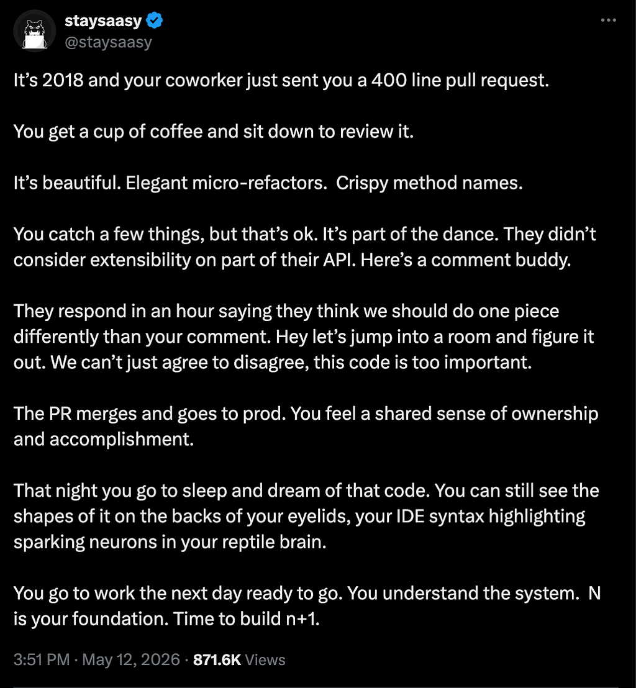

*A 2018 code review, remembered from 2026. Screenshot: [@staysaasy](https://x.com/staysaasy) on X.*

I used to care a lot about my code. Naming, folder structure, where things lived. I'd sit with a bad name for too long because it bothered me, and I'd spend an hour refactoring something that already worked because the shape felt wrong. Coworkers knew to expect long PRs with opinions in the comments.

That's the stuff the tweet is about. You'd actually read a 400-line PR, and when a coworker pushed back it was because they disagreed, not because they were being difficult. You cared enough that the code was still in your head at night.

I don't know exactly when that stopped. The models got good, the timelines got shorter, and at some point I stopped agonizing over names because something else was writing them. It's faster, and the output is fine most of the time. But I can't always tell anymore which parts of my own projects I wrote and which parts got generated.

I'm still using Claude and I'm going to keep using it. I just don't know where the craft part went.
